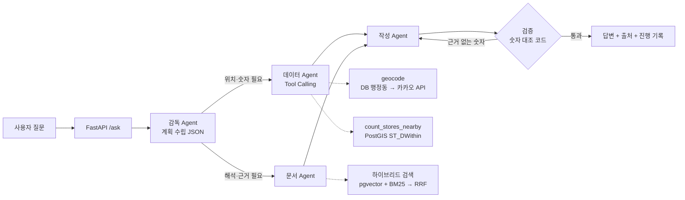

# 상권·입지 분석 AI Agent (geo-agent)

자연어 질문(예: "광화문 근처에서 카페 창업하면 경쟁이 어때?")을 받아
**공간 데이터 분석(PostGIS)** 과 **문서 검색(하이브리드 RAG)** 을 Agent가 스스로 골라 쓰고,
**근거(출처)와 함께** 답하는 Multi-Agent 서비스입니다.

- 분석 범위: 서울 종로구 (상가 21,616곳, 상권 보고서 등 PDF 3종 186개 조각)
- 개발 방식: AI(Claude)와 함께 개발하고, AI가 제안한 코드의 문제를 실제 데이터로 검증하며 고쳤습니다 → [AI 활용 개발 기록](docs/ai-dev-log.md)

## 실행 예시

**질문: 광화문 근처에서 카페 창업하면 경쟁이 어때?**

```
[감독] 담당 배정: 데이터, 문서
[데이터] 도구 호출 geocode({'query': '광화문'}) → ok=True
[데이터] 도구 호출 count_stores_nearby({'lat': 37.5759, 'lon': 126.9768, 'radius_m': 500, 'category': '카페'}) → ok=True
[문서] '광화문 근처 카페 창업 경쟁 분석' → 생활백서 p.11, p.29 / 상권분석 보고서 p.53, p.37
[작성] 답변 작성 완료
[검증] 답변 속 숫자가 모두 근거와 일치
```

> 반경 500m 안에 카페가 105곳으로, 같은 반경의 백반/한정식 108곳과 비슷한 수준입니다.
> 가장 가까운 카페는 236m, 258m, 262m 거리에 있습니다. (…)
> 종로구 소상공인의 창업 준비기간은 평균 16.0개월로 서울시보다 긴 편입니다(출처: 2025 서울시 소상공인 생활백서(종로구편).pdf p.29).

| 질문 | 동작 |
|---|---|
| 광화문 근처 카페 창업 경쟁은? | 지오코딩 → 반경 점포 집계 + 문서 검색 → 출처 포함 답변 |
| 종로구 외식업 생존율은? | 문서만 검색 → 1년 78.8% / 5년 39.9% (서울시 대비) |
| 강남역 맛집 추천해줘 | 분석 범위(종로구) 밖 → "확인할 수 없습니다" (지어내지 않음) |

## 아키텍처



| 구분 | 사용 기술 |
|---|---|
| 언어 / API | Python 3.12, FastAPI |
| Agent | LangGraph (StateGraph, 조건부 분기), OpenAI Tool Calling (gpt-4o-mini) |
| 공간 DB | PostgreSQL 16 + PostGIS (GEOGRAPHY, GIST 인덱스, ST_DWithin) |
| 벡터 검색 | pgvector (HNSW, 코사인 거리), text-embedding-3-small |
| 키워드 검색 | rank_bm25 + kiwipiepy(한국어 형태소 분석), RRF 융합 |
| 외부 API | 카카오 로컬 API (httpx + tenacity 재시도, timeout 3초) |
| 인프라 | Docker Compose |

## 설계에서 고민한 점

**1. 숫자는 LLM이 아니라 코드로 검증**
작성 Agent가 쓴 답변의 숫자를 정규식으로 뽑아 도구 결과·문서 원문에 있는지 코드로 대조합니다.
근거 없는 숫자가 있으면 1회 재작성, 그래도 남으면 경고를 붙입니다.
LLM에게 검증을 맡기면 같은 실수를 반복할 수 있기 때문입니다.

**2. 하이브리드 검색: 벡터 검색이 놓치는 고유명사 보완**
'광화문'은 문서에서 "사직동 광화문역 발달상권 2,017…" 같은 표 안에만 나와서 벡터 유사도가 0.31에 그쳐 검색되지 않았습니다.
BM25 키워드 검색을 더해 RRF로 순위를 합치고, 질문의 고유명사가 조각에 그대로 있으면 유사도 기준을 0.4 → 0.3으로 완화했습니다.

| 질문 | 벡터 검색만 | 하이브리드 |
|---|---|---|
| 광화문 상권 특징은? | p.18, p.37 | p.18, p.37, **p.53 (광화문역 상권 표)** |
| 광화문 근처 카페 창업 경쟁은? | 근거 없음 | **p.53** |
| 종로구 외식업 생존율은? | p.23, p.49, p.28 | p.23, p.28, **p.43 (외식업 생존율 표)** |
| 강남역 맛집 추천해줘 | 근거 없음 | 근거 없음 (유지) |

**3. 근거가 없으면 지어내지 않기**
- 문서 유사도 기준값은 실제 측정으로 정했습니다 (관련 질문 0.43~0.59, 무관한 질문 0.32~0.34 → 0.4).
- 종로구 밖 장소는 지오코딩 단계에서 `out_of_service_area`로 막아, 엉뚱한 위치의 숫자로 답하지 않게 했습니다.
- 평가 세트로 측정해 보니 "부산 해운대 상권"(0.426), "성수동 카페 창업"(0.410)처럼 문서에 없는 질문도 유사도가 정답(광화문 0.41)과 겹쳐 기준값으로는 거를 수 없었습니다. 그래서 **질문의 고유명사가 문서 전체에 하나도 없으면 범위 밖으로 거절**하는 단계를 추가했습니다.

**검색 평가 결과** ([eval/](eval/), 문서에 있는 질문 20개 + 없는 질문 5개, top_k=4)

| 방식 | Hit@4 | Recall@4 | 문서에 없는 질문 거절률 |
|---|---|---|---|
| ① 벡터만 (이전 방식) | 85% | 72% | 40% |
| ② 하이브리드 (BM25 + RRF) | 85% | 73% | 40% |
| ③ ② + 고유명사 일치 시 기준 완화 | 90% | 80% | 40% |
| ④ ③ + 범위 밖 지명 거절 (현재) | **90%** | **80%** | **80%** |

- 개선은 **지명 질문**에서 나왔습니다 (Hit 3/6 → 4/6). 설명형 질문은 벡터 검색만으로도 12/12였습니다.
- 하이브리드만 붙였을 때(②)는 효과가 없었고, 키워드 검색이 찾은 표를 유사도 기준이 다시 버리는 문제를 고친 뒤(③) 효과가 나타났습니다.
- 형태소 분석기에 종로구 17개 행정동 이름을 사용자 사전으로 등록했습니다. "창신2동"이 "창신 / 2 / 동"으로 쪼개져 창신1·3동과 구분되지 않던 문제를 고쳤습니다 (Recall 78% → 80%).
- 남은 실패: "삼청동 상권 유형", "창신2동 상권 문제점". 정답인 요약 문단보다 같은 동 이름이 많이 나오는 **숫자 표**가 앞 순위를 차지합니다 (삼청동 요약 문단은 유사도 0.205). 청크에 제목을 붙여 임베딩하거나 재순위(reranker)를 두는 것이 다음 단계입니다.
- "내일 서울 날씨"는 검색 단계에서는 실패하지만 Agent 전체에서는 정상 처리됩니다 → [트러블슈팅 5](#5-검색-평가에서는-실패-agent-전체에서는-정상-내일-서울-날씨)
- 질문과 정답 쪽은 청크 원문을 직접 보고 지정한 소규모 세트라, 수치는 방향을 보는 용도입니다.

**4. 외부 API 장애 대비**
카카오 API는 timeout 3초, 타임아웃·5xx에만 최대 3회 재시도합니다. 끝내 실패하면, 질문에 행정동 이름이 있을 때 DB의 행정동 중심좌표로 대체합니다.

## 트러블슈팅

원인을 찾아 해결한 사례입니다. 원인은 알지만 아직 해결하지 못한 것은 [한계와 다음 단계](#한계와-다음-단계)에, 전체 13건은 [AI 활용 개발 기록](docs/ai-dev-log.md)에 있습니다.

### 1. 범위 밖 장소인데 숫자가 나온 답변

- **문제**: "강남역 근처 점포는?"에 "강남역 주변 점포 2,590개"라는 답. 도구가 실제로 반환한 숫자라 **숫자 검증도 통과**
- **원인**: 지오코딩 키워드 검색을 종로구 사각형 범위(rect)로 제한해, 범위 밖 장소 대신 범위 안의 엉뚱한 장소가 잡힘
- **해결**: 범위 제한 없이 검색한 뒤 결과 주소가 종로구인지 코드로 확인하고, 밖이면 `out_of_service_area`를 반환해 "분석 범위가 아닙니다"로 안내
- **교훈**: 숫자가 근거에 있는지뿐 아니라, 그 숫자가 **어디에서 왔는지**도 확인해야 함

### 2. 하이브리드 검색을 붙였는데 효과가 없음

- **문제**: BM25가 "사직동 광화문역 발달상권 2,017 …" 표를 찾았지만 최종 결과에서 빠짐 (평가: Recall 72% → 73%로 거의 그대로)
- **원인**: 숫자뿐인 표라 벡터 유사도가 0.315 → 기존 기준 0.4에 걸려 다시 버려짐
- **해결**: 질문의 고유명사가 청크에 그대로 있으면 0.3까지 근거로 인정 (지명만 있는 무관한 조각 0.26은 계속 걸러짐) → **Recall 80%**

### 3. 문서에 없는 질문의 절반 이상이 근거를 받아 감

- **문제**: 평가 세트에서 "부산 해운대 상권", "성수동 카페 창업" 등 문서에 없는 질문 거절률 40%
- **원인**: 기준 0.4를 문서에 없는 질문 하나("강남역 맛집")로만 정했음. "부산 해운대"(0.426)가 정답 청크(광화문 0.41)보다 유사도가 높아 **기준값 조정으로는 구분 불가**
- **해결**: 질문의 고유명사가 문서 전체에 하나도 없으면 범위 밖으로 거절 → **거절률 80%**, 정상 질문 정확도는 그대로
- **중간 오판**: "부산"이 "세**부산**출내역" 안에 있어 문서에 있는 지명으로 판단됨. 형태소 단어로만 비교하자 이번엔 "세종마을음식문화거리"의 "세종"을 놓침 → 형태소 단어 목록에 있거나 원문에서 **단어의 시작**으로 나오면 있다고 판단

### 4. "창신2동"이 "창신 / 2 / 동"으로 쪼개짐

- **문제**: "창신2동 상권의 문제점은?"에서 정답 청크가 키워드 검색 54위
- **원인**: 형태소 분석기 기본 사전에 행정동 이름이 없어 "창신 / 2 / 동"으로 분리. "2"·"동"은 거의 모든 청크에 있어 변별력이 없고, "창신"은 창신1·2·3동을 구분하지 못함
- **해결**: DB의 종로구 행정동 17개를 사용자 사전에 고유명사로 등록 (DB "종로5.6가동"과 보고서 "종로5·6가동"의 표기 차이도 함께 등록) → 상위 8개가 모두 창신2동 청크, Recall 78% → 80%
- **남은 문제**: 같은 동 이름이 많이 나오는 숫자 표가 요약 문단보다 앞에 섬 → [한계와 다음 단계](#한계와-다음-단계)

### 5. 검색 평가에서는 실패, Agent 전체에서는 정상 ("내일 서울 날씨")

- **문제**: 평가 세트에서 "내일 서울 날씨 어때?"가 근거를 반환해 실패로 집계됨. "서울"은 문서에 있는 지명이라 범위 밖 지명 거절(3번)로도 걸러지지 않음
- **확인**: 평가는 **문서 검색 단계만 떼어 시험**한 것이라, 실제 서비스 흐름에서도 문제가 되는지 Agent 전체로 다시 실행함

  ```
  질문: 내일 서울 날씨 어때?
  [감독] 담당 배정: 없음 / 계획: {'needs_data': False, 'needs_docs': False, ...}
  [작성] 답변 작성 완료
  [답변] 제공된 데이터로는 확인할 수 없습니다.
  ```

- **결과**: 실제 서비스에서는 검색 앞단의 **감독 Agent가 상권 질문이 아니라고 판단해 문서 검색을 부르지 않음** → 정상 처리. 코드 수정 없이 결과 해석을 바로잡음
- **배운 점**: 걸러내는 책임이 단계별로 나뉘어 있음

  | 단계 | 거르는 것 |
  |---|---|
  | 감독 Agent (LLM) | 질문의 **종류** — 날씨처럼 상권과 무관한 질문 |
  | 범위 밖 지명 거절 | 문서에 없는 **지역** — 해운대, 성수동 |
  | 유사도 기준 | 뜻이 **먼** 조각 |

  단계 하나만 평가한 숫자로 서비스 전체를 판단하면 안 되며, 감독 Agent의 판단까지 포함한 **Agent 전체 평가**를 다음 단계로 둠

## 실행 방법

```powershell
# 1) DB 실행 (PostgreSQL + PostGIS + pgvector)
docker compose up -d --build

# 2) 라이브러리 설치
python -m venv .venv
.\.venv\Scripts\python.exe -m pip install -r requirements.txt

# 3) 환경 변수: OPENAI_API_KEY, KAKAO_REST_API_KEY 입력
copy .env.example .env

# 4) 데이터 적재
.\.venv\Scripts\python.exe -m scripts.load_stores "data\raw\<서울 상가정보 CSV>"
.\.venv\Scripts\python.exe -m app.rag.ingest        # data\docs\*.pdf

# 5) 서버 실행 → http://localhost:8000/docs
.\.venv\Scripts\python.exe -m uvicorn app.main:app --reload
```

| API | 설명 |
|---|---|
| `GET /health` | 서버·DB 상태, 적재된 상가·문서 조각 수 |
| `POST /ask` | `{"question": "..."}` → 답변, 계획, 진행 기록, 근거 없는 숫자 목록, 처리 시간 |
| `POST /search/docs` | 문서 검색만 실행 (`mode`: `hybrid` / `vector` 비교용) |

개별 확인용 스크립트: `scripts.try_tools`(도구 단독), `scripts.try_rag`(문서 검색), `scripts.compare_search`(벡터 vs 하이브리드), `scripts.ask`(Multi-Agent 전체), `eval.run_eval`(검색 평가 → `eval/results.md`)

## 데이터 출처

원본 데이터는 저장소에 포함하지 않습니다 (용량·저작권). 아래에서 받아 `data/` 폴더에 넣습니다.

- 상가 데이터: 소상공인시장진흥공단 상가(상권)정보, 서울 2026.06 기준 (공공데이터포털) → `data/raw/`
- 문서 (`data/docs/`)
  - 2025 종로구 상권분석 보고서 (서울신용보증재단)
  - 2025 서울시 소상공인 생활백서(종로구편) (서울신용보증재단)
  - 빅 데이터 기반의 상권 서비스 확장을 위한 설문조사시스템 설계 및 구현 (한국빅데이터논문지)

## 한계와 다음 단계

- **의미 검증의 한계**: 숫자 검증은 "값이 근거에 있는지"만 확인합니다. 숫자는 맞지만 원문에 없는 비교를 만드는 오류는 프롬프트 규칙으로만 막고 있습니다.
- **평가 세트 확장**: 지금은 검색 평가(25문항)만 있습니다. 질문 수를 늘리고, 검색뿐 아니라 최종 답변의 정확도까지 채점하는 것이 다음 단계입니다.
- **청킹 개선**: 글자 수 대신 문단·동네 단위로 자르고, 청크마다 제목을 붙여 임베딩해 숫자 위주 청크의 검색을 개선합니다.
- **Agent 전체 평가**: 지금 평가는 검색 단계만 봅니다. 감독 Agent의 판단까지 포함한 전체 흐름 평가가 필요합니다.
- **지오코딩 이중화**: 카카오 API 장애 시 VWorld 지오코더로 대체하는 경로를 추가할 계획입니다.
- **범위 확장**: 종로구 → 서울 전체 확장 시 BM25 메모리 색인을 PostgreSQL 전문 검색 등으로 바꿔야 합니다.
